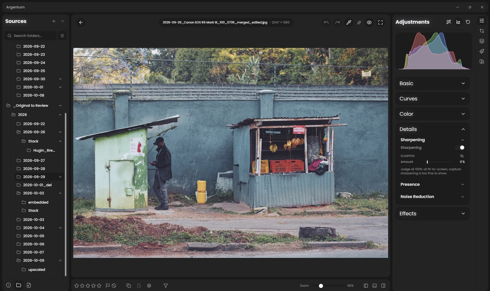

# Argentum

**A free RAW photo editor that opens your photos the way Lightroom does.** Fast on
the graphics card, with AI masks and your camera's own lens corrections, built from
the best of [RapidRAW](https://github.com/CyberTimon/RapidRAW),
[darktable](https://github.com/darktable-org/darktable),
[RawTherapee](https://github.com/RawTherapee/RawTherapee) and
[RAWmakase](https://github.com/pch/rawmakase).

[](https://github.com/akhater/Argentum/releases/latest)
[](LICENSE)



**[Download for Windows or macOS](https://github.com/akhater/Argentum/releases/latest)**
(Linux builds too, not yet tried) · open source · no account, no subscription

- **Looks right the moment it opens.** RAWs start the way Lightroom's default shows
  them: each camera's own exposure offset (280 bodies), Adobe's tone curve and
  Lightroom's default sharpening.
- **Your camera's own lens correction**, read from the file for Fujifilm, Sony,
  Nikon, Olympus and OM System, Panasonic, Samsung, recent Canon bodies and DNG,
  with lensfun's database for the rest.
- **AI masks in one click:** Subject, Sky and Background, or click any object.
  The models run on your computer.
- **Fast:** edits render on the graphics card, and a faster RAW decoder is one
  setting away for Canon, Fujifilm, Olympus, Panasonic and Pentax files.
- **Looks:** presets, LUTs and film emulations in one tab, and Lightroom presets
  can be imported.
- **Your photos stay yours:** edits live in a small file next to each photo, and
  the RAW itself is never changed.

> **Early preview.** Used daily on Windows and run on macOS. Keep your own
> backups, as you would with any young tool.

---

## Status

**Early preview**, used daily on Windows.

| Platform | State |
|---|---|
| **Windows** | Tested on x64, the platform it is developed on. ARM64 is built, not yet tried |
| **macOS** | Tested on Apple Silicon, after the two one-time steps below. Intel is built, not yet tried |
| **Linux** | Builds in CI, never run by anyone. Reports welcome |

It is cross-platform because RapidRAW is, and nothing Argentum added breaks that.
Windows and macOS have been run; on Linux "compiles" is not yet "works", and
nobody has checked.

---

## Install

Grab an installer from [**Releases**](https://github.com/akhater/Argentum/releases):

| | Files |
|---|---|
| **Windows** | `.exe` (installer) or `.msi`, for x64 or ARM64 |
| **macOS** | `.dmg`, for Apple Silicon (`aarch64`) or Intel (`x64`) |
| **Linux** | `.AppImage`, `.deb` or `.rpm`, for x64 or ARM64 |

Nothing else to install. The AI models are not shipped in the installer, so it
stays small: each one is downloaded the first time a feature needs it, or all at
once from *Settings → AI and models*.

No download includes camera tethering; see
[Tethering](#tethering-macos-and-linux).

*(Building from source is further down, and only needed if you want to change
the code.)*

### Windows: the first start

The installer is not code-signed yet, so Windows SmartScreen may say "Windows
protected your PC" the first time. Choose **More info**, then **Run anyway**.

### macOS: two one-time steps

Argentum is not yet signed or notarized by Apple, so macOS needs two things
done once. Only do this with a DMG from the official Argentum release.

**1. Let it open.** Copy `Argentum.app` from the DMG to `/Applications`. Without
this step macOS reports it as "damaged". In Terminal, run:

```bash
xattr -dr com.apple.quarantine "/Applications/Argentum.app"
open "/Applications/Argentum.app"
```

**2. Let it read your photos.** macOS protects Documents, Desktop, Downloads,
Pictures and external drives. Open *System Settings → Privacy & Security → Files
and Folders* and allow Argentum the folders your photos are in. If Argentum is
not listed there, add `/Applications/Argentum.app` under *Full Disk Access*.
Then quit and reopen Argentum. This opens the right page:

```bash
open "x-apple.systempreferences:com.apple.preference.security?Privacy_FilesAndFolders"
```

No Terminal command can grant this access; it has to be allowed in System
Settings.

### macOS: folders made by an import script

On Windows a new folder takes its permissions from the folder it is made in.
macOS does not do that: a new folder gets whatever permissions the program that
made it gives it. Folders created by an import script, or by one run with
`sudo`, can end up where Argentum may not read the photos or save their
`.agdata` edit files.

**Fix the folders already there.** In Finder, select the parent folder, choose
*File → Get Info*, unlock with the padlock, give your account *Read & Write*
under *Sharing & Permissions*, then choose *Apply to enclosed items* from the
⋯ (or gear) menu below the list. This is a one-time copy: folders made later do not get
it.

**Make new folders inherit it.** Run this once on the parent folder; every
folder and file created inside it afterwards gets the same access:

```bash
chmod -R +a "$(whoami) allow list,add_file,search,delete,add_subdirectory,delete_child,readattr,writeattr,readextattr,writeextattr,readsecurity,file_inherit,directory_inherit" "/path/to/your/photos"
```

If the script ran with `sudo`, its folders belong to another user and the
command above is refused. Take them back first:

```bash
sudo chown -R "$(whoami)" "/path/to/your/photos"
```

### Tethering (macOS and Linux)

Tethering, RapidRAW's feature for shooting with a camera on USB straight into the
app (live view, camera controls, captures saved into the open folder), is
available only when [building from source](#building-from-source) with
`--features tethering`; no download includes it. It is built on
[libgphoto2](http://gphoto.org/proj/libgphoto2/support.php), and such a build does
not start unless libgphoto2 is installed. A Camera section then appears in the
left column. There is no tethering on Windows.

---

## What Argentum adds

**The picture**

- **RAWs open looking like Lightroom's default** (DNG Standard): each camera's own
  exposure offset (RAWmakase's table, 280 bodies), Adobe's default tone curve and
  Lightroom's default sharpening. Photos shot in a mode that holds highlights back
  (Fujifilm DR200/DR400, Canon Highlight Tone Priority, Nikon Active D-Lighting,
  Olympus gradation, Pentax D-Range) get those stops back. The earlier renderings
  are still in *Edit → Profile → Rendering*.
- **Colour built the way the DNG specification builds it**, for new edits: the
  camera's matrices are mixed for the light the photo was taken in, so tungsten and
  stage light lose the magenta a daylight-only matrix gave them (from RapidRAW
  1.6.7). Edits made before keep the colour they had.
- **B&W** with Lightroom's measured black-and-white mix, an Auto mix per photo, and
  **Color Grading** that tints as strongly as Lightroom's, both from RAWmakase.
- **White balance presets** as Lightroom has them (As Shot, Auto, Daylight,
  Cloudy, Shade, Tungsten, Fluorescent, Flash, with Camera Raw's numbers), and an
  **Auto** ported from darktable's illuminant detection.
- **Camera profiles.** A profile describes how your particular camera sees colour.
  Argentum reads DCP profiles, fetches one for your body, and keeps the cameras
  you shoot with under *Settings → My Gear*, where each can be given the profile
  its new photos open with.
- **Highlight recovery.** When a bright area clips in one channel, the two that
  survived say what colour it was — so the channel is rebuilt before demosaic
  rather than smeared to white.
- **A clipping warning that steps through the channels** — off, luminance, R, G, B
  — so you can see which channel is about to lose everything.
- **Display colour management.** The preview is converted for the monitor's own
  ICC profile, so what you see matches what you export. Windows only for now; see
  Known limitations.
- **An RGB readout**, so a colour under the cursor can be measured instead of
  argued about.

**Detail and lenses**

- **Capture sharpening from RawTherapee**, which undoes the slight blur of lens and
  sensor, and a manual Sharpen from darktable, each with an eye that shows where it
  works. Every mask has a Sharpen of its own.
- **Restore** makes a lens that is soft wide open look closer to its sharpest, at
  the photo's own size (OmniLens, downloaded on first use).
- **The camera's own lens correction**, read from the file and applied the way
  Lightroom applies it: Fujifilm, Sony, Nikon Z and Coolpix P950/P1000/P1100,
  Olympus and OM System, Panasonic and Leica, Samsung NX, Canon EOS R5 Mark II and
  R6 Mark III, and the corrections a DNG carries (the readers are RAWmakase's).
  Phone DNGs get their corner shading corrected.
- **Automatic lens detection on every RAW format**, so lensfun's corrections apply
  without picking the lens by hand. Under *Settings → My Gear → My Lenses*, a lens
  can be set to correct every new photo taken with it.
- **A faster RAW decoder to choose.** *Settings → Processing → RAW decoder*, or per
  photo in *Edit → Profile*: FlashRaw reads Canon CR3 and CR2, Fujifilm compressed
  RAF, Olympus, Panasonic and Pentax files 1.5 to 3.4 times faster than rawler, with
  identical pixels. Every other file still opens with rawler, the default.
- **Canon sRAW and mRAW fixed** (they came out green with crushed shadows), and
  Nikon High Efficiency RAWs open.

**Editing**

- **One window** for the photos, the folders and the editor, in Lightroom
  Classic's neutral greys, with the Edit panel in the order a photo is corrected in.
- **AI masks**: Subject, Sky and Background in one click, and Object by clicking on
  it, on SAM 2.1 as RAWmakase runs it.
- **Looks**: presets, LUTs and film looks in one place, with LUTs suggested for each
  photo, applied to one photo or to every photo selected.
- **History and Snapshots stay with the photo.** Undo still works after opening
  another photo or restarting the app, and Snapshots keep named versions of an edit
  beside it, in its `.agdata` file.
- **Says when a new release is out**, beside the Settings gear. Nothing is
  downloaded or installed by itself.

RapidRAW's own features (its AI tools, Relight, Fog, panorama, HDR, focus
stacking, negative conversion, healing, export, and tethering in a build from
source) are all still here; RapidRAW Cloud, their paid service, is not. Full
detail, with the source file and commit for every harvested tool, is in
[CHANGELOG.md](CHANGELOG.md). What is planned is in
[docs/ROADMAP.md](docs/ROADMAP.md).

---

## Known limitations

**The screen conversion is Windows-only, and needs a matrix profile.** Argentum
reads the ICC profile Windows holds for the monitor the window is on and converts
the preview for it. On macOS and Linux nothing is read and nothing is converted,
and the same is true of a monitor profile built as a lookup table rather than
from three primaries. In those cases the picture is shown the way RapidRAW always
showed it — correct on an sRGB screen, over-saturated on a wide-gamut one.

**Linux is untested.** As above: built, never run.

The app also lists what is currently broken in *Settings → About → Known issues*,
which is kept current rather than being a changelog entry that goes stale.

---

## Where the app keeps its files

In the operating system's own application-data folder, under
`co.argentum.editor`:

| | Windows | macOS | Linux |
|---|---|---|---|
| Settings, AI models, presets, My Gear | `%APPDATA%\co.argentum.editor` | `~/Library/Application Support/co.argentum.editor` | `~/.local/share/co.argentum.editor` |
| Thumbnail cache | `%LOCALAPPDATA%\co.argentum.editor` | `~/Library/Caches/co.argentum.editor` | `~/.cache/co.argentum.editor` |
| Log (`app.log`, for bug reports) | `%LOCALAPPDATA%\co.argentum.editor\logs` | `~/Library/Logs/co.argentum.editor` | `~/.local/share/co.argentum.editor/logs` |

**This is not configurable yet.** A portable, one-folder installation is on the
roadmap and is not built.

The one thing kept outside: `.agdata` edit files sit next to your photos, so your
edits travel with the pictures rather than living in a database you have to back
up separately.

---

## Building from source

Only needed if you want to change the code. You need Rust (rustup fetches the
version pinned in `src-tauri/rust-toolchain.toml` by itself), Node 22 or later,
and a C++ toolchain.

On Windows:

```bash
winget install Microsoft.VisualStudio.2022.BuildTools --override "--quiet --add Microsoft.VisualStudio.Workload.VCTools --includeRecommended"
```

```bash
winget install Rustlang.Rustup
```

```bash
winget install OpenJS.NodeJS.LTS
```

On macOS install Xcode command line tools, Rust via [rustup](https://rustup.rs)
and Node. On Linux, Rust and Node plus the packages CI installs on Ubuntu:

```bash
sudo apt-get install -y libwebkit2gtk-4.1-dev build-essential curl wget file libssl-dev libayatana-appindicator3-dev librsvg2-dev patchelf pkg-config
```

Then, on any of them:

```bash
npm install
```

Run a development window that reloads as you edit:

```bash
npm run tauri dev
```

With tethering (macOS and Linux). Install libgphoto2 first: `brew install
libgphoto2 pkg-config` on macOS, `sudo apt-get install -y libgphoto2-dev` on
Ubuntu.

```bash
npm run start:tethering
```

Build an installer for the machine you are on:

```bash
npm run tauri build
```

The same with tethering, which no download includes:

```bash
npm run tauri build -- --features tethering
```

---

## Staying current with RapidRAW

Argentum was forked at RapidRAW 1.6.6 and never merges it. Each later release is
read, and what is worth having is copied by hand, one change at a time, credited
in [CHANGELOG.md](CHANGELOG.md) with the commit it came from. `npm run
check:sources` says when a release is waiting to be read. The steps are in
[ARCHITECTURE.md](docs/ARCHITECTURE.md#harvesting-from-rapidraw).

---

## Docs

| File | What's in it |
|---|---|
| [docs/ARCHITECTURE.md](docs/ARCHITECTURE.md) | Code layout, the engine, and how RapidRAW releases are harvested |
| [src-tauri/engine/README.md](src-tauri/engine/README.md) | The engine: adding a tool is one file and one registry line |
| [docs/ADDING_A_TOOL.md](docs/ADDING_A_TOOL.md) | The older recipe, for tools not yet moved into the engine |
| [docs/ROADMAP.md](docs/ROADMAP.md) | What is planned, in what order |
| [docs/MENU.md](docs/MENU.md) | Everything available to harvest, from each source |
| [docs/FEASIBILITY.md](docs/FEASIBILITY.md) | The original go/no-go research |
| [docs/RELEASING.md](docs/RELEASING.md) | How a release is cut, and the speed check it must pass |
| [bench/README.md](bench/README.md) | Comparing two builds: interface smoothness and export speed |
| [src/shell/README.md](src/shell/README.md) | The engine's test bench, an interface for exercising its contract |
| [CHANGELOG.md](CHANGELOG.md) | Every module, with its upstream source and commit |
| [CREDITS.md](CREDITS.md) | Whose work this is built on |

---

## Credits and licence

Argentum began as a fork of [RapidRAW](https://github.com/CyberTimon/RapidRAW) by
Timon Käch, whose GPU pipeline, catalogue and editing panels are still most of the
application. It is becoming an editor of its own: a processing engine where every
tool is one file in a registry, with tools taken from darktable, RawTherapee,
RAWmakase and RapidRAW, each credited to the file and commit it came from. It was
forked at RapidRAW 1.6.6 and no longer merges it: later releases are harvested by
hand, like the other sources. How and why is in
[docs/ARCHITECTURE.md](docs/ARCHITECTURE.md).

Argentum is independently maintained and is **not affiliated with, nor endorsed
by, RapidRAW, darktable, RawTherapee or RAWmakase.** It says where its parts come
from because their work deserves the credit, not because they have any part in
this one.

Argentum is other people's work with additions on top. **[CREDITS.md](CREDITS.md)**
names them, and the same list is in the app under *Settings → About → Credits*.

Licensed **AGPL-3.0**, inherited from RapidRAW and unchanged. See
[LICENSE](LICENSE).
